# 3x8 Decoder using 1x2 Decoder
### Hierarchical Digital VLSI Design in Verilog
> A **3x8 decoder** built entirely from **1x2 decoder** building blocks, demonstrating hierarchical, modular digital design. Includes the original circuit-level report (CMOS schematics + waveforms) and a Verilog RTL equivalent that mirrors the same hierarchy.

---

## Table of Contents

- [3x8 Decoder Block](#3x8-decoder-block)
- [What is a 3x8 Decoder?](#what-is-a-3x8-decoder)
- [Details of the 3x8 Decoder](#details-of-the-3x8-decoder)
- [Applications](#applications)
- [Advantages](#advantages)
- [Limitations](#limitations)
- [Repository Structure](#repository-structure)
- [Circuit Schematics](#circuit-schematics)
- [Truth Table](#truth-table)
- [Hierarchical Design](#hierarchical-design)
- [RTL Implementation](#rtl-implementation)
- [Simulation](#simulation)
- [Conclusion](#conclusion)
- [Future Scope](#future-scope)

---

## 3x8 Decoder Block

The complete 3x8 decoder built hierarchically from 1x2 decoder blocks:

| 3x8 Decoder Block |
|-------------------|
| 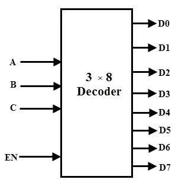 |

---

## What is a 3x8 Decoder?

A 3x8 decoder (also written as 3-to-8 decoder) is a combinational logic circuit that takes **3 input bits** and activates **one out of 8 outputs** based on the binary value of the inputs. Each output corresponds to one possible combination of the input values.

```
Inputs:   A  B  C          (3 bits)
             |  |  |
             v  v  v
         +-------------+
         |  3x8 Decoder |
         +-------------+
             |  |  |  |  |  |  |  |
             v  v  v  v  v  v  v  v
Outputs:  Y0 Y1 Y2 Y3 Y4 Y5 Y6 Y7    (8 lines, only one HIGH at a time)
```

Decoders like this are widely used in digital systems, such as **memory address decoding**, **demultiplexing**, and **instruction decoding in CPUs**.

---

## Details of the 3x8 Decoder

| Item    | Description                                        |
|---------|----------------------------------------------------|
| Inputs  | 3 binary input lines (called **A, B, C**)          |
| Outputs | 8 output lines (**Y0 to Y7**)                      |

Each output line corresponds to one unique combination of the input lines. When a particular combination is applied, **only one output line becomes HIGH (logic 1)** while all others remain LOW (logic 0).

---

## Applications

| Application            | Role                                                  |
|------------------------|-------------------------------------------------------|
| Memory address decoding | Selecting one of 8 memory blocks                    |
| Instruction decoding   | Decoding CPU opcodes                                  |
| Multiplexers / demultiplexers | Input/output selection                        |
| Embedded systems       | Enabling one of multiple devices                      |

---

## Advantages

| Advantage                  | Explanation                                                                 |
|----------------------------|-----------------------------------------------------------------------------|
| Efficient binary-to-output conversion | Translates 3-bit binary input into one of 8 unique outputs          |
| Simple, fast selection logic | Only one output is HIGH at a time -> simpler control logic            |
| Reduces hardware complexity | A decoder replaces many manual logic-gate control signals              |
| Used in memory and CPU circuits | Address decoding in RAM/ROM; opcode decoding in CPUs             |
| Scalable for larger systems | Cascadable into 4x16, 5x32, ... decoders                             |
| Low power (when properly designed) | Only one output active at any time                            |
| Enables mux/demux         | Core of communication, data-routing and signal-switching circuits    |

---

## Limitations

| Limitation                       | Explanation                                                         |
|----------------------------------|---------------------------------------------------------------------|
| Fixed input/output size          | Only 3 inputs / 8 outputs; larger decoders need cascading           |
| One output active at a time      | Not suited for applications needing multiple simultaneous outputs   |
| No built-in enable control       | Basic design needs extra logic to gate the decoder                  |
| Hardware grows exponentially     | 2^n outputs for n inputs -> more gates, area, power, delay         |
| Not reversible                   | Cannot recover the input from the output alone                      |
| No error handling                | Assumes perfect inputs; no detect/correct of errors                 |
| Sensitive to glitches            | Propagation delays can cause momentary wrong outputs on fast changes|

---

## Repository Structure

```
DIGITAL_VLSI_3x8_Decoder/
|
+-- report/
|   +-- DIGITAL VLSI DESIGN.docx   # Original assignment report
|   +-- DIGITAL VLSI DESIGN.pdf    # PDF export of the report
|
+-- figures/
|   +-- cmos_inverter.png          # CMOS inverter schematic
|   +-- nand_gate.png              # NAND gate schematic
|   +-- and_gate.png               # AND gate schematic
|   +-- decoder_1x2.png            # 1x2 decoder (with enable)
|   +-- decoder_3x8.png            # Full 3x8 decoder schematic
|   +-- tb_and.png                 # AND gate test-bench
|   +-- tb_1x2_decoder.png         # 1x2 decoder test-bench
|   +-- tb_3x8_decoder.png         # 3x8 decoder test-bench
|   +-- waveform_output_1.png      # Simulation waveform
|   +-- waveform_output_3.png      # Simulation waveform
|   +-- 3x8_decoder_block.jpeg     # 3x8 decoder block diagram
|
+-- rtl/
|   +-- decoder1x2.v               # 1x2 decoder module (DUT block)
|   +-- decoder3x8.v               # Hierarchical 3x8 decoder (top)
|   +-- decoder3x8_tb.v            # Self-checking testbench
|
+-- README.md                      # This documentation
```

---

## Circuit Schematics

### Gate-level building blocks

| Figure | Description |
|--------|-------------|
| 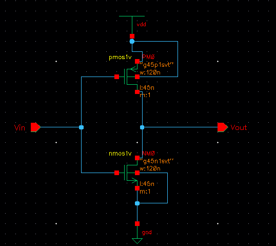 | CMOS inverter |
| 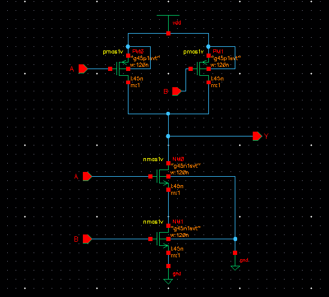 | NAND gate |
| 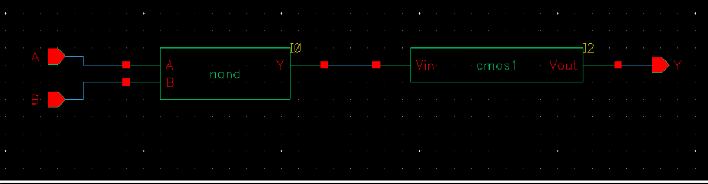 | AND gate |

### Decoder stages

| Figure | Description |
|--------|-------------|
| 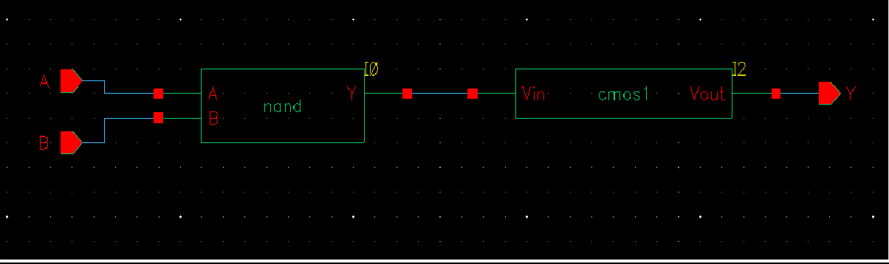 | 1x2 decoder (with enable) |
| 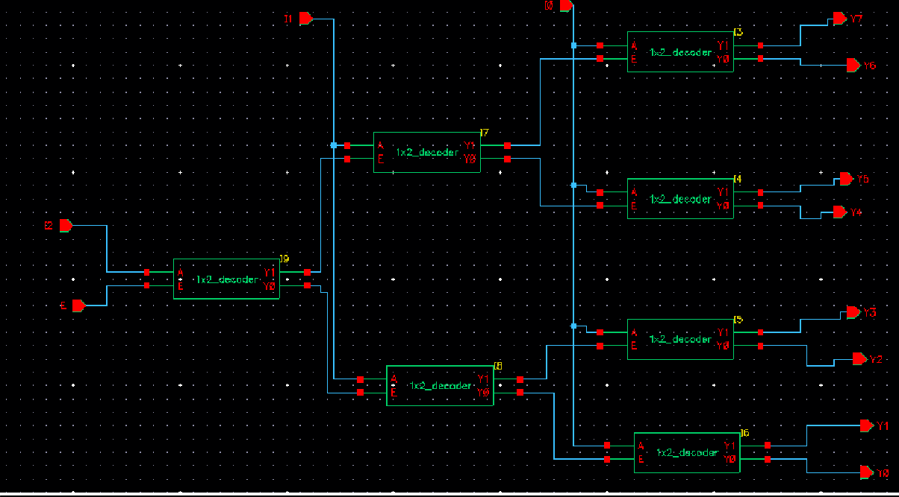 | Full 3x8 decoder built from 1x2 blocks |

### Test-bench circuits

| Figure | Description |
|--------|-------------|
| 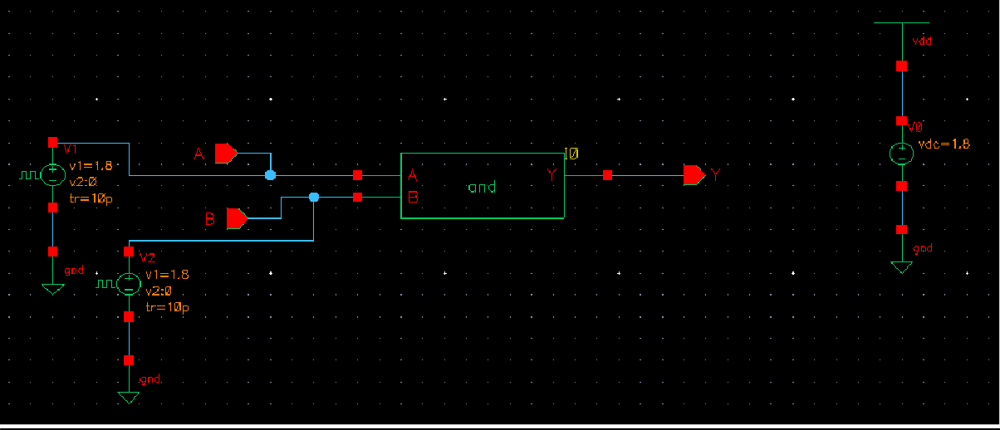 | AND gate test-bench |
| 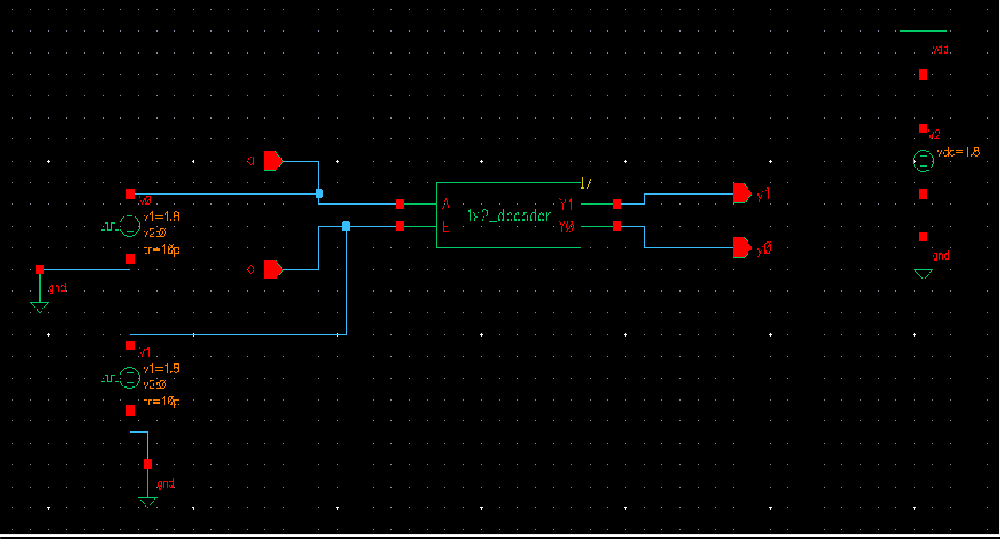 | 1x2 decoder test-bench |
| 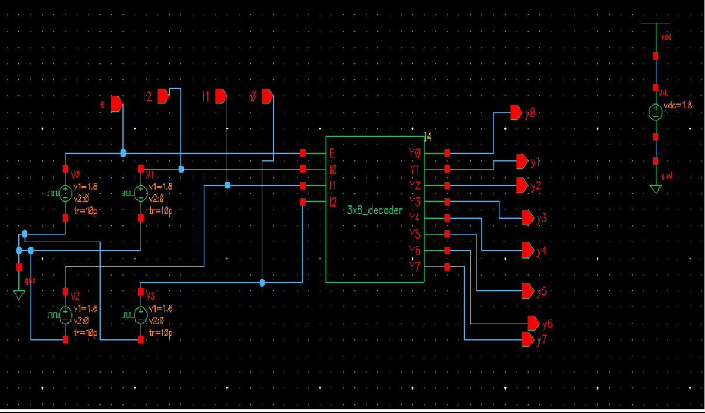 | 3x8 decoder test-bench |

### Simulation waveforms (outputs)

| Waveform | Waveform |
|----------|----------|
| 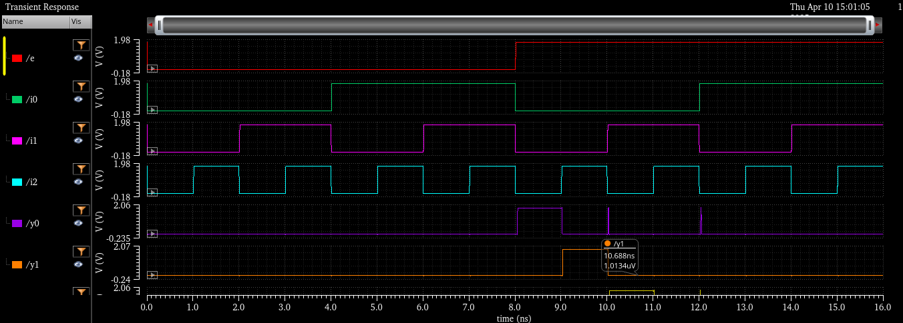 | 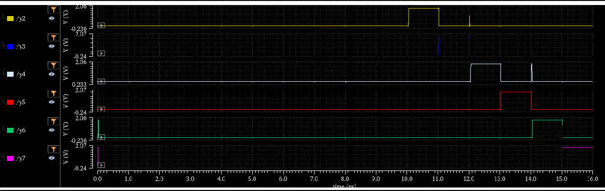 |

---

## Truth Table

### 1x2 Decoder

| Input `in` | Enable `en` | `y0` | `y1` |
|------------|-------------|------|------|
| 0          | 1           | 1    | 0    |
| 1          | 1           | 0    | 1    |
| X          | 0           | 0    | 0    |

### 3x8 Decoder (`EN = 1`)

| `A` | `B` | `C` | `Y7` | `Y6` | `Y5` | `Y4` | `Y3` | `Y2` | `Y1` | `Y0` |
|-----|-----|-----|------|------|------|------|------|------|------|------|
| 0   | 0   | 0   | 0    | 0    | 0    | 0    | 0    | 0    | 0    | **1** |
| 0   | 0   | 1   | 0    | 0    | 0    | 0    | 0    | 0    | **1**| 0    |
| 0   | 1   | 0   | 0    | 0    | 0    | 0    | 0    | **1**| 0    | 0    |
| 0   | 1   | 1   | 0    | 0    | 0    | 0    | **1**| 0    | 0    | 0    |
| 1   | 0   | 0   | 0    | 0    | 0    | **1**| 0    | 0    | 0    | 0    |
| 1   | 0   | 1   | 0    | 0    | **1**| 0    | 0    | 0    | 0    | 0    |
| 1   | 1   | 0   | 0    | **1**| 0    | 0    | 0    | 0    | 0    | 0    |
| 1   | 1   | 1   | **1**| 0    | 0    | 0    | 0    | 0    | 0    | 0    |

With `EN = 0`, **all** outputs are 0.

---

## Hierarchical Design

The 3x8 decoder is built from **seven 1x2 decoder** instances arranged in three stages:

```
            +--------------------------------------------------------+
            |                    decoder3x8                          |
            |                                                       |
   A ------>|  1x2 (stg1) -> e0, e1      (A selects upper/lower)   |
   B ------>|  2x 1x2 (stg2) -> f0..f3   (B selects quarter)        |
   C ------>|  4x 1x2 (stg3) -> Y[0..7]  (C selects the output bit) |
   EN ----->|                                                       |
            +--------------------------------------------------------+
```

**Total: 7 x decoder1x2 = 1 + 2 + 4** (one decoder in stage 1, two in stage 2, four in stage 3).

This mirrors the circuit-level report where the CMOS gates are grouped as 1x2 decoders and cascaded.

---

## RTL Implementation

### `rtl/decoder1x2.v`

```verilog
module decoder1x2(
    input  wire in,
    input  wire en,
    output wire y0,
    output wire y1
);
    assign y0 = en & ~in;
    assign y1 = en & in;
endmodule
```

### `rtl/decoder3x8.v`

Builds the hierarchy with seven `decoder1x2` instances:

```verilog
decoder1x2 stg1 (.in(A), .en(EN), .y0(e0), .y1(e1));

decoder1x2 stg2a (.in(B), .en(e0), .y0(f0), .y1(f1));
decoder1x2 stg2b (.in(B), .en(e1), .y0(f2), .y1(f3));

decoder1x2 stg3_0 (.in(C), .en(f0), .y0(Y[0]), .y1(Y[1]));
decoder1x2 stg3_1 (.in(C), .en(f1), .y0(Y[2]), .y1(Y[3]));
decoder1x2 stg3_2 (.in(C), .en(f2), .y0(Y[4]), .y1(Y[5]));
decoder1x2 stg3_3 (.in(C), .en(f3), .y0(Y[6]), .y1(Y[7]));
```

---

## Simulation

### Option 1 - Vivado xsim (2018.2)

```bash
xvlog decoder1x2.v decoder3x8.v decoder3x8_tb.v
xelab decoder3x8_tb -s dec_snap
xsim dec_snap -runall
```

### Option 2 - Icarus Verilog

```bash
iverilog -o sim decoder1x2.v decoder3x8.v decoder3x8_tb.v
vvp sim
```

Both tools print: `PASS: all test cases passed`.

### Test coverage

| # | Scenario                  | What is verified                          |
|---|---------------------------|-------------------------------------------|
| 1 | All 8 combinations (EN=1) | Exactly the matching `Y` bit is HIGH      |
| 2 | Enable off (EN=0)         | All outputs are 0                         |
| 3 | Combinational enable      | Dropping `EN` clears outputs immediately  |

---

## Conclusion

The 3x8 decoder was implemented hierarchically using only 1x2 decoders, demonstrating:

- Hierarchical / modular logic design
- Use of enable signals to control each stage
- Output selection based on binary input patterns

These techniques scale to larger decoders (4x16, 5x32) and are fundamental to memory selectors, control units and multiplexer-based architectures.

---

## Future Scope

| Direction                 | Detail                                                    |
|---------------------------|-----------------------------------------------------------|
| Larger decoders           | Build 4x16 / 5x32 from 1x2 or 2x4 blocks                  |
| Hardware implementation   | Test on breadboard with 74-series ICs or on an FPGA       |
| Global enable integration | Add a master `EN` with power-saving multi-decoder support |
| Fault tolerance           | Parity checks / self-test logic                           |
| Timing analysis           | Propagation delay through each decoder level              |

---

## Concepts Referenced

- **Decoder** - combinational circuit that converts binary code to one-of-many active outputs
- **1x2 Decoder** - smallest decoder building block: `y0 = en & ~in`, `y1 = en & in`
- **Enable Signal** - gates the whole decoder; all outputs 0 when `EN = 0`
- **Hierarchical Design** - larger modules built by instantiating smaller ones (1 + 2 + 4 = 7 blocks)
- **CMOS Logic** - pull-up/pull-down network implementation of the gates
- **Self-checking Testbench** - asserts expected outputs for all 8 input combinations

---

## License

MIT - see [LICENSE](LICENSE).

---

<div align="center">

**Decoders are the foundation of memory selection, instruction decoding, and mux/demux routing.**

3x8 Decoder &nbsp; | &nbsp; CMOS Schematics in Report &nbsp; | &nbsp; 3x8 = 7 x 1x2

</div>
